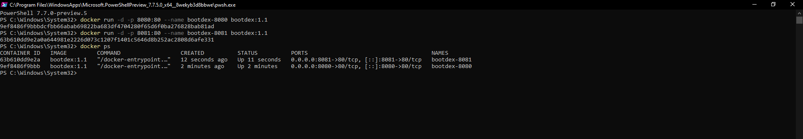

# BootDex — Etapas 01 e 02

Pokédex em HTML, CSS e JavaScript, com favoritos compartilhados no PostgreSQL do Supabase e frontend servido por Nginx em Docker. A documentação da Etapa 01 foi preservada ao final.

## Links e situação da entrega

- [Repositório GitHub](https://github.com/nicolasfp-ui/Bootdex-Trabalho-de-bootcamp)
- [Aplicação no GitHub Pages](https://nicolasfp-ui.github.io/Bootdex-Trabalho-de-bootcamp/)
- **Docker Hub: pendente** de confirmação do Docker ID e publicação. Após publicar, substituir este item pelo link `https://hub.docker.com/r/SEU_DOCKER_ID/bootdex`.

**Este README ainda é uma preparação para a entrega.** O código de criar/listar/excluir está implementado, mas `config.js` ainda está sem URL e chave pública do Supabase. As alterações da branch `etapa-02` precisam ser integradas/publicadas para aparecer no Pages. Não há imagem publicada nem evidências da SQ4 nesta versão. O identificador informado, `nicolasfp-ui`, contém hífen; a documentação atual do Docker exige Docker IDs individuais com letras minúsculas e números. Confirme o identificador real no perfil antes de preencher os comandos.

Os commits foram preparados localmente: a conexão GitHub disponível tinha somente leitura. Veja [como importar e enviar os seis commits](docs/como-aplicar.md) usando o bundle incluído no pacote.

### Exportação em quatro arquivos

O projeto completo usa arquivos separados para a configuração e os favoritos. Para entregar somente `index.html`, `script.js`, `style.css` e `README.md`, execute `node scripts/exportar-quatro.cjs PASTA_DESTINO`. Essa exportação incorpora a configuração e os favoritos no `script.js` e remove as referências extras do HTML; nela, preencha o Supabase no início do `script.js`. Não copie apenas quatro arquivos da versão modular: a busca agora tolera a ausência da integração, mas os favoritos precisam de seus módulos ou da exportação consolidada.

## Persistência — Etapa 02

### Dados e funcionamento

Cada registro é um Pokémon favorito. A lista é **pública e compartilhada, sem login**: todos os visitantes podem salvar e excluir. Não representa uma coleção privada de cada navegador.

| Coluna | Tipo e restrições | Finalidade |
| --- | --- | --- |
| `id` | UUID, chave primária | Identificador para exclusão |
| `pokemon_id` | integer positivo, único | Número do Pokémon; impede duplicatas |
| `nome` | text, 1–100 caracteres | Nome retornado pela PokéAPI |
| `criado_em` | timestamptz, padrão `now()` | Data/hora gerada pelo banco |

`favoritos-api.js` usa `fetch` na API REST oficial do Supabase (`/rest/v1/favoritos`): `POST` cria, `GET` lista por data e `DELETE` remove pelo UUID. Não exige instalar a biblioteca do Supabase. A lista carrega ao abrir a página e pode ser atualizada pelo botão **Atualizar lista**. **Abrir** consulta a PokéAPI pelo número salvo; o contador mostra os registros carregados.

Os registros ficam no PostgreSQL, sem fallback para localStorage. Fechar o navegador ou recriar o container não deve apagá-los. A busca, sugestões, filtros, shiny e demais recursos da Etapa 01 foram mantidos.

### Configurar o Supabase

1. Crie um projeto em [Supabase](https://supabase.com/), preferencialmente na região South America.
2. No **SQL Editor**, execute [supabase/schema.sql](supabase/schema.sql). Ele cria a tabela, habilita RLS e concede apenas leitura, criação e exclusão para `anon`.
3. Confira nas configurações que a **Data API** está habilitada e o schema `public` está exposto.
4. Copie a Project URL e uma chave **publishable** (`sb_publishable_...`) ou **anon public** legada. Preencha `config.js`:

```javascript
window.BOOTDEX_CONFIG = {
    url: "https://SEU-PROJETO.supabase.co",
    chavePublica: "SUA_CHAVE_PUBLICA"
};
```

5. Sirva o site por HTTP e recarregue. Para Pages, publique também o arquivo preenchido; para Docker, preencha antes do build ou use a montagem indicada abaixo.

URL e chave pública são configuração do frontend. **Nunca use senha, `service_role` ou `sb_secret_...` no site ou na imagem.** Criar um `.env` sozinho não configura este frontend estático. Sem configuração, a busca continua funcionando, com explicação e botões de persistência desabilitados.

### RLS e limitações

As políticas abertas para `anon` são uma simplificação acadêmica permitida pelo enunciado: qualquer visitante pode ler, inserir e excluir. Não armazene dados pessoais. Para favoritos privados seriam necessários Supabase Auth, coluna `user_id` e políticas por usuário. Não há update nem sincronização em tempo real: use **Atualizar lista** para alterações feitas em outro navegador. A listagem respeita o limite de linhas da Data API (normalmente 1.000); não há paginação nesta demonstração.

### Validar o banco real

1. Pesquise `pikachu`, salve e confirme a linha no Table Editor.
2. Feche o navegador, abra novamente e confira que o favorito permanece.
3. Abra em outro navegador: a lista compartilhada deve ser a mesma.
4. Salve Pikachu outra vez: deve aparecer aviso de duplicata, sem criar outra linha.
5. Exclua e confirme a remoção no banco e após recarregar.
6. Repita pelo container e confira que recriá-lo não apaga os favoritos.

**Esses passos ainda dependem de um projeto Supabase configurado e não foram validados contra banco real neste ambiente.**

## Execução local e Docker

Na pasta do projeto, preencha `config.js` e use Live Server no VS Code, ou Python instalado:

```powershell
python -m http.server 8000
```

Abra [localhost:8000](http://localhost:8000). Para Docker, instale e **inicie Docker Desktop em modo Linux containers**. `docker version` precisa exibir Client e Server. Na raiz:

```powershell
docker build -t bootdex:1.1 .
docker run -d -p 8080:80 --name bootdex-8080 bootdex:1.1
docker ps
docker logs bootdex-8080
```

Abra [localhost:8080](http://localhost:8080). O Dockerfile usa `nginx:stable-alpine`, copia explicitamente os seis arquivos do frontend e expõe a porta 80. O banco continua no Supabase; PokéAPI, imagens e banco exigem internet.

```powershell
docker stop bootdex-8080
docker rm bootdex-8080
```

Para trocar o projeto Supabase sem reconstruir a imagem, monte um `config.js` público preenchido (PowerShell):

```powershell
$configPath = (Resolve-Path ./config.js).Path
docker run -d -p 8080:80 --name bootdex-config --mount "type=bind,source=$configPath,target=/usr/share/nginx/html/config.js,readonly" bootdex:1.1
```

Não há substituição por `docker run -e`: Nginx serve arquivos estáticos. Não reutilize nomes de containers existentes nem portas ocupadas.

## Sidequests obrigatórias

### SQ1 — .dockerignore

O [.dockerignore](.dockerignore) exclui `.git`, documentação, testes, dependências, arquivos `.env` e rascunhos do contexto. Isso reduz os arquivos enviados e o trabalho do build. O `COPY` explícito evita conteúdo desnecessário na imagem final. Excluir arquivos do contexto não reduz camadas que já não os copiavam; o tamanho final depende do conteúdo copiado e da imagem base.

**Situação:** arquivo implementado, build pendente de serviço Docker ativo.

### SQ2 — versões 1.0, 1.1 e latest

**1.0:** commit `570a177`, com CRUD e Docker. **1.1:** a partir de `fbf0d52`, acrescenta **Abrir** nos favoritos e contador. `latest` deve apontar para 1.1. Publique versões diferentes, preservando a primeira.

Crie um repositório **público** `bootdex` no Hub. Confirme seu Docker ID e substitua a primeira linha abaixo. Execute em PowerShell, na raiz da versão atual, com `config.js` preenchido:

```powershell
$dockerId = "SEU_DOCKER_ID"
docker login --username $dockerId

# Use um destino ainda inexistente para a cópia da primeira versão.
git clone . ../Bootdex-1.0
git -C ../Bootdex-1.0 checkout 570a177
Copy-Item ./config.js ../Bootdex-1.0/config.js
docker build -t "${dockerId}/bootdex:1.0" ../Bootdex-1.0
docker run -d -p 8082:80 --name bootdex-teste-10 "${dockerId}/bootdex:1.0"
# Teste http://localhost:8082 e o CRUD antes de publicar.
docker push "${dockerId}/bootdex:1.0"

docker build -t "${dockerId}/bootdex:1.1" .
docker run -d -p 8083:80 --name bootdex-teste-11 "${dockerId}/bootdex:1.1"
# Teste http://localhost:8083 e a melhoria antes de publicar.
docker push "${dockerId}/bootdex:1.1"
docker tag "${dockerId}/bootdex:1.1" "${dockerId}/bootdex:latest"
docker push "${dockerId}/bootdex:latest"
```

Confira as três tags no Hub e salve um print em `docs/evidencias/dockerhub-tags.png`.

**Situação:** código das duas versões preparado; nenhuma imagem construída/publicada ou tag confirmada.

### SQ3 — descrição no Docker Hub

Copie [docs/dockerhub-overview.md](docs/dockerhub-overview.md), substitua `SEU_DOCKER_ID` e publique no campo **Overview**. O texto inclui descrição, comando e GitHub. Salve evidência em `docs/evidencias/dockerhub-overview.png`.

**Situação:** texto preparado; publicação pendente.

### SQ4 — dois containers e Kubernetes

Com a imagem local construída e `bootdex-8080` em execução:

```powershell
docker run -d -p 8081:80 --name bootdex-8081 bootdex:1.1
docker ps --filter "name=bootdex-808" --format "table {{.Names}}\t{{.Image}}\t{{.Status}}\t{{.Ports}}"
```

Abra [localhost:8080](http://localhost:8080) e [localhost:8081](http://localhost:8081). Capture o **terminal real** com duas linhas em execução, mostrando `8080->80` e `8081->80`. Salve em `docs/evidencias/docker-ps-dois-containers.png` e faça commit. Depois insira neste README:

```markdown

```

Se eu tivesse 100 containers, usaria Kubernetes para coordená-los em um **cluster**, conjunto de máquinas que executa as cargas. Um **Pod** agrupa um ou mais containers; neste frontend, cada Pod poderia executar um Nginx. Um **Deployment** mantém o número desejado de **réplicas** de Pods e substitui os que falham. Um **Service** fornece acesso estável e distribui tráfego entre eles. Isso evita iniciar e acompanhar manualmente 100 processos. Todas as réplicas continuariam usando o mesmo Supabase. Esta sidequest exige pesquisa, não implantação de Kubernetes.

**Situação:** explicação e roteiro preparados; execução simultânea e captura pendentes.

## Comando para o avaliador

**Pendente de publicação.** Após confirmar o Docker ID e publicar a imagem pública com o Supabase configurado, substitua o marcador no comando e acrescente o link real do Hub no início do README:

```powershell
docker run -d -p 8080:80 SEU_DOCKER_ID/bootdex:1.1
```

Teste em ambiente sem a imagem local antes de entregar. Não deixe `SEU_DOCKER_ID` no README final.

## Testes e verificações

Node.js 20 ou superior:

```powershell
npm test
```

Testes de interface com Playwright:

```powershell
npm install
npx playwright install chromium
npm run test:browser
```

Alternativamente, para usar Edge instalado no Windows, configure `$env:BROWSER_CHANNEL = "msedge"` antes de `npm run test:browser`.

Foram verificados **3 testes da API e 5 de interface**, cobrindo criar/reabrir/excluir, erros e duplicata, ausência de configuração, busca/shiny, abrir favorito, gravação seguida de falha ao atualizar a lista e busca quando faltam módulos dos favoritos. As respostas das APIs são controladas: **os testes não comprovam execução do SQL, RLS real ou gravação no Supabase**.

O build foi tentado, mas o serviço Docker local não estava ativo (`dockerDesktopLinuxEngine` indisponível). Imagem e containers não foram validados. O workflow [verificar.yml](.github/workflows/verificar.yml) está preparado para testar, construir e servir a imagem no GitHub Actions; o resultado dependerá de sua execução no GitHub.

## Histórico — seis novos commits

O histórico original foi preservado. A branch `etapa-02` organiza a evolução em seis commits:

1. `4be7bcd` — Supabase, configuração, SQL/RLS e testes da API.
2. `1fb6aa3` — integração dos favoritos e testes de navegador.
3. `9a44f9c` — distinguir falha de gravação de falha ao atualizar a lista.
4. `570a177` — Dockerfile e `.dockerignore`, base da versão 1.0.
5. `fbf0d52` — abrir favoritos e contador, melhoria 1.1.
6. `docs: documentar entrega, sidequests e verificações automatizadas` — documentação e workflow.

Confira com `git log --oneline`. Ao integrar, **preserve os commits, sem squash**, para manter a evolução exigida. Configuração e evidências reais podem gerar commits adicionais.

Uma correção posterior aos seis commits iniciais protege a busca quando faltam os módulos de favoritos e acrescenta a exportação funcional em quatro arquivos.

## Checklist para a entrega no Moodle

- [ ] Executar SQL, preencher `config.js` e validar CRUD no Supabase real.
- [ ] Integrar a branch com os seis commits e publicar a Etapa 02 no Pages.
- [ ] Iniciar Docker Desktop, construir e testar 1.0 e 1.1.
- [ ] Confirmar Docker ID e publicar repositório público com `1.0`, `1.1` e `latest`.
- [ ] Publicar overview, preencher o link do Hub e o comando final.
- [ ] Capturar e commitar os prints reais das tags, overview e dois containers.
- [ ] Inserir as imagens no README com URLs absolutas do GitHub/raw, para funcionarem ao entregar o arquivo isoladamente.
- [ ] Testar links e comando em máquina limpa; enviar **somente o README.md atualizado**.

## Referências

- [Supabase: API REST](https://supabase.com/docs/guides/api/quickstart)
- [Supabase: chaves](https://supabase.com/docs/guides/getting-started/api-keys) e [RLS](https://supabase.com/docs/guides/database/postgres/row-level-security)
- [Docker: construir e publicar](https://docs.docker.com/get-started/docker-concepts/building-images/build-tag-and-publish-an-image/)
- [Dockerfile](https://docs.docker.com/reference/dockerfile/) e [regras do Docker ID](https://docs.docker.com/accounts/individual/create-account/)
- [Kubernetes: Pods](https://kubernetes.io/docs/concepts/workloads/pods/) e [Deployments](https://kubernetes.io/docs/concepts/workloads/controllers/deployment/)

---

# Etapa 01 — documentação preservada

## Descrição

A BootDex é uma aplicação web frontend que permite pesquisar Pokémon pelo nome ou número e visualizar informações úteis de forma organizada.

Além da busca principal, a aplicação possui pesquisa avançada por geração e tipo, sugestões de Pokémon durante a digitação e visualização da versão shiny quando disponível.

## API utilizada

- **PokéAPI:** https://pokeapi.co/
- **Documentação:** https://pokeapi.co/docs/v2

### Endpoints consumidos

- `https://pokeapi.co/api/v2/pokemon/{nome-ou-id}`
- `https://pokeapi.co/api/v2/pokemon`
- `https://pokeapi.co/api/v2/type/{tipo}`
- `https://pokeapi.co/api/v2/generation`
- `https://pokeapi.co/api/v2/generation/{id}`
- Endpoint de espécie disponibilizado pela própria resposta da PokéAPI

## Funcionalidades

- Buscar Pokémon pelo nome ou número
- Exibir nome e número do Pokémon
- Exibir imagem oficial do Pokémon
- Exibir tipo(s) do Pokémon
- Exibir altura e peso
- Exibir experiência base
- Exibir quantidade de habilidades
- Exibir descrição do Pokémon
- Layout responsivo para diferentes tamanhos de tela
- Mostrar sugestões durante a digitação
- Pesquisar Pokémon por geração
- Pesquisar Pokémon por tipo
- Exibir avisos para buscas inválidas ou falhas na API
- Combinar filtros de geração e tipo
- Alternar entre imagem normal e versão shiny

## Tecnologias utilizadas

- HTML5
- CSS3
- JavaScript
- Fetch API
- PokéAPI
- Git e GitHub
- GitHub Pages

## Como executar localmente

1. Clone o repositório:

   `git clone https://github.com/nicolasfp-ui/Bootdex-Trabalho-de-bootcamp.git`

2. Entre na pasta do projeto:

   `cd Bootdex-Trabalho-de-bootcamp`

3. Abra o arquivo `index.html` no navegador.

Também é possível executar o projeto usando a extensão Live Server no Visual Studio Code.

## Links

- **Aplicação no ar (GitHub Pages):** https://nicolasfp-ui.github.io/Bootdex-Trabalho-de-bootcamp/
- **Repositório:** https://github.com/nicolasfp-ui/Bootdex-Trabalho-de-bootcamp
